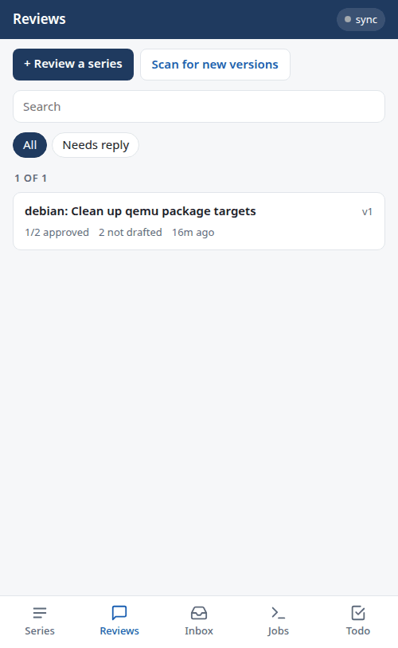
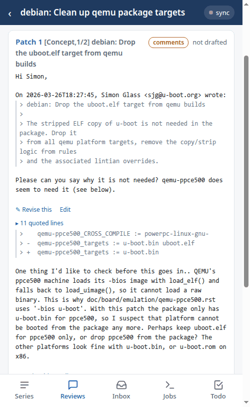
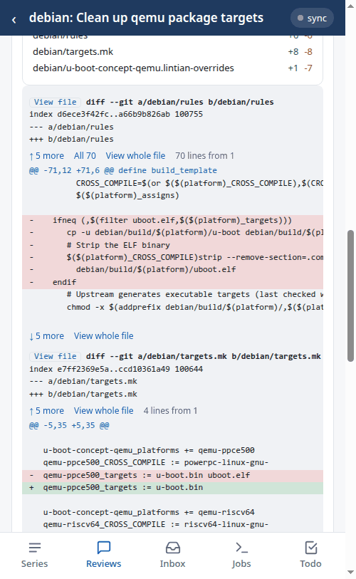

.. SPDX-License-Identifier: GPL-2.0+

Following it all from a phone
=============================

``patman serve`` runs a small web server in your git tree, showing your
series and your reviews on a page made for a phone. From the page you can
also read the patches, change and send reviews, and start new ones.

This follows on from :doc:`reviewing`, using the same review of series 155.
The pictures are of the page, served from the tree used there.

Starting the server
-------------------

Run it in the git tree which holds the database::

    $ patman serve
    Serving on http://127.0.0.1:8040/

and open that address in a browser on the same machine. To use it from a
phone on your network, listen on all addresses and give a token, which the
page asks for the first time it is opened::

    $ patman serve --host 0.0.0.0 -t my-secret
    Serving on http://0.0.0.0:8040/?token=my-secret

Use the address of the machine, e.g. ``http://myhost:8040/?token=my-secret``;
the page remembers the token. If reviews are kept in a separate database
(``review_db_dir``), the server finds it in the same way as
``patman review``.

To keep the status of your series up to date, add ``-s``, which gathers it
from patchwork every hour, or every so many minutes with ``-s 30``. ``-r``
also syncs the Gmail drafts of your reviews and finds replies to them.

The tabs
--------

The tabs along the bottom of the page are:

Series
    Your own series, with the state of their patches on patchwork

Reviews
    The series you have reviewed with ``patman review``

Inbox
    The most recent series on patchwork, marking those you have reviewed

Jobs
    Commands started from the page, with their output

Todo
    Series marked with ``patman workflow todo``, due ones first

The Reviews tab lists the reviewed series, with how many reviews approve
and whether their drafts have been created:

Reading a review
----------------

Tap a series to see its reviews, one card for each patch. Long quotes are
folded, e.g. '11 quoted lines', and open when tapped:

Each review has 'Show the patch', which shows the commit message and diff
just below it, so that the two can be read together. 'View file' shows the
whole of a changed file, and the buttons between the chunks show more of the
lines around them:

Working on the reviews
----------------------

A review which has not been sent can be changed on the page:

- 'Edit' under a comment changes just that comment, and 'Edit' under the
  review changes the whole text
- 'Revise this' under a comment, or 'Revise' under the review, asks the
  agent to change it following a note, as ``patman review --revise`` does
- 'Redraft' recreates its Gmail draft, and 'Send' sends it

These run as jobs, but the page stays where it is: each review a job acts
on shows how it is getting on, then the new text, with 'Show changes' to see
what was there before. Until the job finishes, the review cannot be changed
again, from this page or any other.

'Review a series' on the Reviews tab starts a review, as ``patman review``
does, and the Inbox tab shows recent series to choose from.

:doc:`The web server chapter </serve>` describes the page in full, and how
to run the server as a service, so that it is always there.
